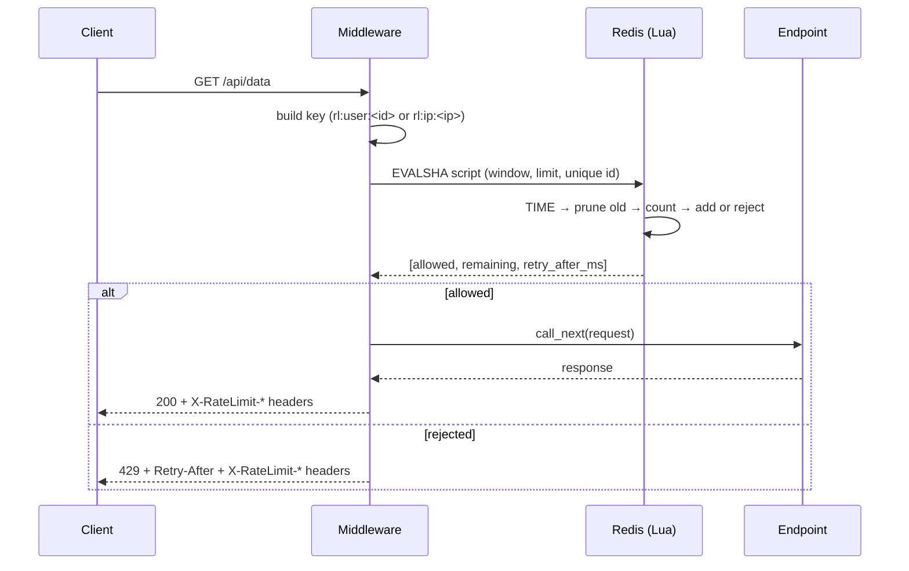

# Distributed Rate Limiter

A rate-limiting middleware for **FastAPI** that enforces one shared limit across any number of API instances. It uses the **Sliding Window Log** algorithm, stored in **Redis** sorted sets and executed atomically by a **Lua** script.

**Stack:** Python 3.11 · FastAPI · Redis 7 · Lua · Docker · pytest · k6

---

## What it does

- Intercepts every request in middleware, before it reaches your endpoint.
- Identifies the caller by `X-User-ID` header (falls back to client IP).
- Allows at most `N` requests per rolling time window per caller (default: 100 per 60 s).
- Returns `429 Too Many Requests` with a `Retry-After` header when the limit is exceeded.
- Adds `X-RateLimit-Limit` and `X-RateLimit-Remaining` headers to every response.
- Enforces the limit **globally**: a caller cannot get more quota by spreading requests across several API instances, because all instances share one counter in Redis.

## Why it is built this way

| Requirement | How it is met |
|---|---|
| **Global enforcement** | State lives in Redis, not in the API process. Every instance reads and writes the same sorted set. |
| **Atomic accuracy** | The whole check-and-record logic runs as one Lua script. Redis executes scripts without interleaving other commands, so concurrent requests cannot race. |
| **Low latency** | One network round trip per request, using `EVALSHA` so only a 40-character hash is sent, not the script text. |
| **No boundary bursts** | Sliding window instead of fixed window (see below). |

---

## Architecture

```
                          ┌──────────────────────────────┐
                          │         FastAPI node         │
   Client ──── HTTP ────▶ │  ┌────────────────────────┐  │
                          │  │  Rate-limit middleware │  │
                          │  └───────────┬────────────┘  │
                          │              │ allowed?      │
                          │       yes    ▼     no        │
                          │  ┌──────────────┐  ┌───────┐ │
                          │  │ GET /api/data│  │  429  │ │
                          │  └──────────────┘  └───────┘ │
                          └──────────────┬───────────────┘
                                         │ EVALSHA (1 round trip)
   More nodes ──────────────────────────▶│
   (same shared state)                   ▼
                          ┌──────────────────────────────┐
                          │            Redis             │
                          │  rl:user:alice  (ZSET)       │
                          │  rl:ip:1.2.3.4  (ZSET)       │
                          │  + Lua script (atomic)       │
                          └──────────────────────────────┘
```

### Request flow



---

## The algorithm: Sliding Window Log

Each caller has a **sorted set** in Redis. Each member is one request. The **score** is the request's timestamp in milliseconds.

For every incoming request, the Lua script does the following in a single atomic step:

1. **Read the time** from Redis itself (`TIME`).
2. **Prune**: remove every entry with a score older than `now - window`.
3. **Count** the entries left (`ZCARD`).
4. **Decide**:
   - `count < limit` → add this request (`ZADD`), refresh the key's TTL, return `{1, remaining, 0}`.
   - otherwise → return `{0, 0, retry_after}`, where `retry_after` is when the oldest entry leaves the window.

### Worked example

Limit = 3 per 10 seconds.

```
t=1s   request A  → count 0 → allowed   set = {1s}
t=2s   request B  → count 1 → allowed   set = {1s, 2s}
t=3s   request C  → count 2 → allowed   set = {1s, 2s, 3s}
t=4s   request D  → count 3 → REJECTED  retry_after = 1s + 10s - 4s = 7s
t=11.5 request E  → prune 1s (older than 1.5s) → count 2 → allowed
```

The window is always "the last 10 seconds from right now", not a clock-aligned bucket.

### Why not a fixed window?

A fixed-window counter (`INCR` + `EXPIRE`) resets at bucket boundaries. A client can send 100 requests at 0:59 and 100 more at 1:01, getting 200 in two seconds while never breaking the "100 per minute" rule. The sliding window has no boundary, so that burst is impossible.

---

## Design decisions

| Decision | Reason |
|---|---|
| **Unique member per request** (`<ms>-<uuid>`) | Sorted-set members are unique. Using the timestamp alone as the member makes two same-millisecond requests collapse into one entry, so the count undercounts and the limit can be exceeded. The score stays the timestamp (used for pruning); the member is just a unique label. |
| **Redis `TIME` inside the script** | If each gateway passed its own `now`, clock differences between machines would make the window inconsistent. Redis is the single clock. |
| **Script returns `{allowed, remaining, retry_after}`** | The middleware needs all three to set `X-RateLimit-Remaining` and `Retry-After` without extra round trips. |
| **`register_script()` at startup** | The client hashes the script once and calls `EVALSHA`, so the script text is not resent on each request. |
| **`redis.asyncio` client** | A blocking client would stall the event loop during the network round trip and slow every other request. |
| **One shared connection pool** | Created once in the FastAPI `lifespan` hook, reused by every request. |
| **Fail open** | If Redis is unreachable, requests are let through and the error is logged. A Redis outage should not take the whole API down. For login or payment endpoints you may prefer to fail closed. |
| **Namespaced keys** (`rl:user:…`, `rl:ip:…`) | A user ID can never collide with an IP address. |
| **Keys expire automatically** (`PEXPIRE`) | Inactive callers' data cleans itself up. |


---

## Getting started

### Prerequisites

Python 3.11+, Docker, and [k6](https://k6.io/docs/get-started/installation/) (only for load tests).

### Run

```bash
# 1. Start Redis
docker compose up -d

# 2. Install dependencies
python -m venv .venv
source .venv/bin/activate        # Windows: .venv\Scripts\activate
pip install -r requirements.txt

# 3. Start the API
uvicorn app.main:app
```

### Try it

```bash
curl -i http://localhost:8000/api/data
```

```
HTTP/1.1 200 OK
x-ratelimit-limit: 100
x-ratelimit-remaining: 99
```

Use a small limit to see throttling quickly:

```bash
RATE_LIMIT=5 uvicorn app.main:app          # PowerShell: $env:RATE_LIMIT=5
for i in $(seq 1 7); do curl -s -o /dev/null -w "%{http_code}\n" http://localhost:8000/api/data; done
# 200 200 200 200 200 429 429
```

Different callers get separate buckets:

```bash
curl -i -H "X-User-ID: alice" http://localhost:8000/api/data
```

### Configuration

| Variable | Default | Meaning |
|---|---|---|
| `REDIS_URL` | `redis://localhost:6379/0` | Redis connection string |
| `RATE_LIMIT` | `100` | Max requests per window per caller |
| `RATE_WINDOW_MS` | `60000` | Window size in milliseconds |

### Response headers

| Header | When | Meaning |
|---|---|---|
| `X-RateLimit-Limit` | always | Configured limit |
| `X-RateLimit-Remaining` | always | Requests left in the current window |
| `Retry-After` | on `429` | Seconds until a slot frees up |
| `X-RateLimit-Check-Ms` | always | Time spent in the Redis check (debug/benchmark header) |

---

## Testing

### Unit and integration tests

Requires Redis running.

```bash
pip install -r requirements-dev.txt
pytest -v
```

The suite covers:

- same-millisecond requests are all counted (the bug fix)
- exactly 100 of 250 concurrent calls are allowed
- the window slides and frees capacity
- `remaining` and `retry_after` values
- response headers on success
- `429` with `Retry-After` after the limit
- separate buckets per user
- fail-open when Redis is unavailable

### Prove the "distributed" behaviour

Run two independent API processes against the same Redis and alternate requests between them:

```bash
RATE_LIMIT=5 uvicorn app.main:app --port 8000 &
RATE_LIMIT=5 uvicorn app.main:app --port 8001 &

for i in 1 2 3 4 5 6 7 8; do
  port=$((8000 + i % 2))
  curl -s -o /dev/null -w "port $port -> %{http_code}\n" http://localhost:$port/api/data
done
```

Expected: five `200`s then three `429`s in total, regardless of which port served each request. Neither process knows about the other; the shared Redis key enforces the limit.

### Load tests (k6)

**Correctness under a concurrent burst.** 50 virtual users send 250 requests in total from one identity against a limit of 100. Start the API with the default limit and flush Redis first (the window is 60 s, so leftover entries would skew the count):

```bash
uvicorn app.main:app
docker compose exec redis redis-cli FLUSHALL
k6 run load_test.js
```

**Steady-state latency.** Use a very high limit so nothing is throttled:

```bash
RATE_LIMIT=1000000 uvicorn app.main:app     # PowerShell: $env:RATE_LIMIT=1000000
docker compose exec redis redis-cli FLUSHALL
k6 run latency_test.js
```

---

## Results

Measured locally (Windows, one uvicorn worker, Redis in Docker, k6 on the same machine).

**Correctness: 250 requests, 50 concurrent VUs, one identity, limit 100/min**

| Status | Count | Threshold |
|---|---|---|
| `200 OK` | **100** | `== 100` ✅ |
| `429 Too Many Requests` | **150** | `== 150` ✅ |
| Other / errors | **0** | `== 0` ✅ |

**Rate-limit check latency (server-measured, Redis round trip only)**

| Scenario | median | p95 |
|---|---|---|
| Steady load: 10 VUs, ~950 req/s | 3.5 ms | **5.5 ms** |
| Instant burst: 250 requests in ~0.3 s | 11 ms | 31 ms |

The burst figure is higher because 50 requests are in flight on a single event loop and queue for their turn; Redis itself answers in about a millisecond. All numbers are from localhost, so a real network adds latency.

---

## Limitations and trade-offs

- **Memory is O(limit) per caller.** Every allowed request is stored. That is trivial at 100/min, but not at 100,000/min. For very high limits, a sliding-window counter (two fixed buckets weighted by overlap) or a token bucket trades a little accuracy for constant memory.
- **Identity is trusted.** `X-User-ID` is read straight from the header. In production it should come from a verified auth token.
- **Behind a reverse proxy, the client IP is the proxy's.** All anonymous users would share one bucket. Read `X-Forwarded-For` only from a trusted proxy.
- **Redis is a single point of failure for enforcement.** The fail-open policy keeps the API available during an outage but disables limiting while it lasts. High availability would need Redis replication or Cluster.
- **Fail-open also swallows script errors.** A bug in the Lua script is logged but does not block traffic, so watch the logs (this was found the hard way during development). Splitting handling so only connection and timeout errors fail open would make bugs loud.
- **`BaseHTTPMiddleware` has some overhead.** A pure ASGI middleware would be slightly faster.
- **Benchmarks are single-machine.** Client, API and Redis share one CPU, so treat absolute numbers as indicative.

## Possible next steps

- Per-route and per-tier limits (free vs paid)
- Pure ASGI middleware, with before/after latency numbers
- Prometheus `/metrics` for allowed, rejected and fail-open counts
- Dockerized API with several replicas behind nginx for a one-command distributed demo
- Token bucket or sliding-window counter variant for high-volume limits
